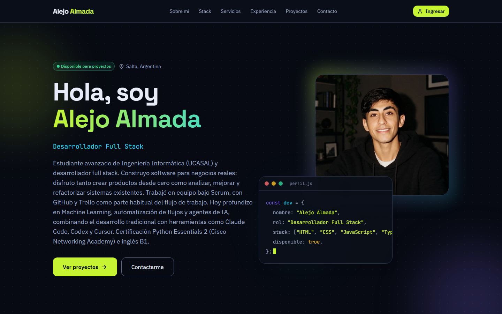
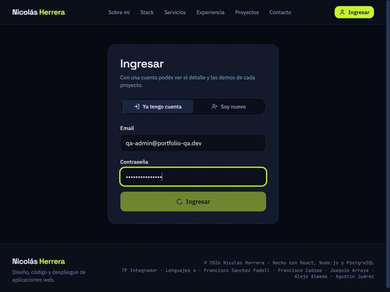
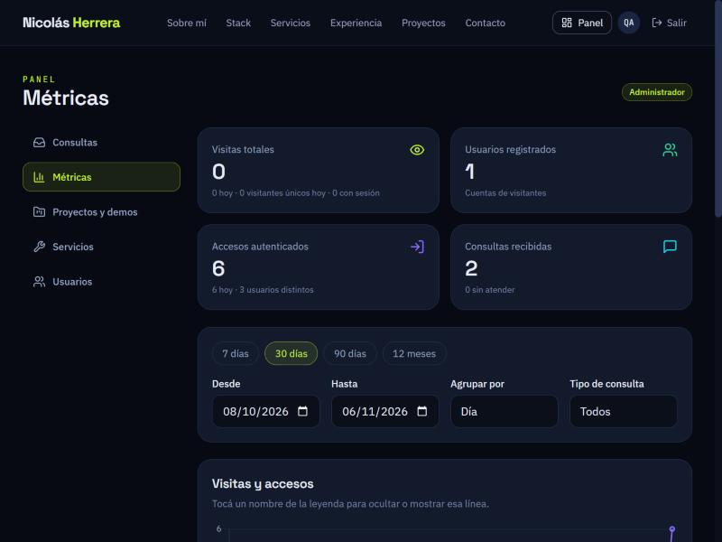
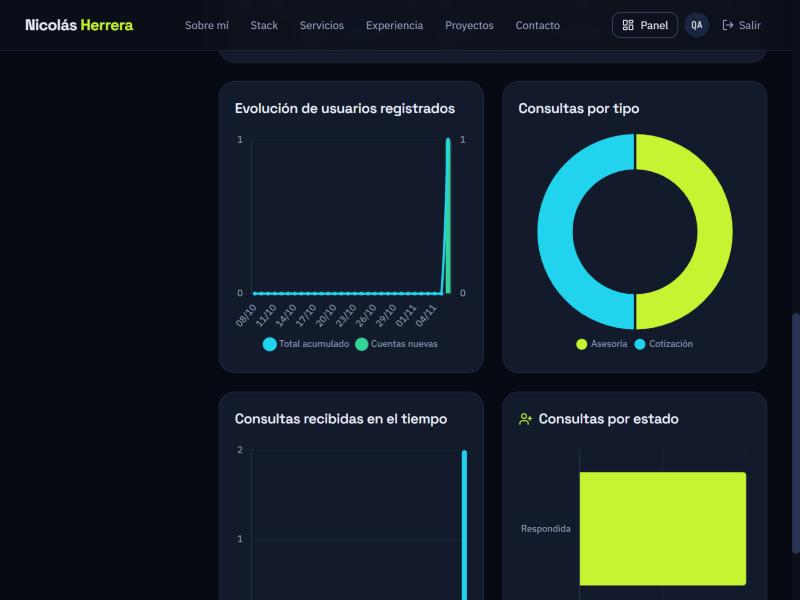
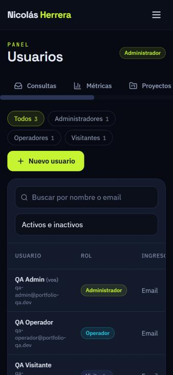

# Portfolio fullstack — Manual de marca (anteproyecto)

> TP Integrador · Lenguajes 4 · Portfolio de desarrollador fullstack (versión **Promoción**)
> Integrantes: Sanchez Fadell, Francisco · Cadima, Francisco · Arraya, Joaquín · Almada, Alejo · Juárez, Agustín
> Este documento es el **anteproyecto**: define la identidad visual, los layouts y las reglas de diseño del sitio. Todo lo que dice acá está implementado en `client/src/index.css` (tokens) y en los componentes de `client/src/componentes/`.

Este es el portfolio de *Nicolás Herrera*, un desarrollador fullstack ficticio. Las reglas valen para el sitio público, el panel del operador y el panel del administrador. Si el grupo prefiere un perfil real, se reemplazan el nombre y los datos de `server/scripts/seed.js` sin tocar ninguna regla de diseño.

El archivo [`tokens.json`](tokens.json) contiene todos los valores de este manual en formato de datos (útil para importarlos a Figma u otra herramienta).

---

## 1. Concepto

| | |
|---|---|
| **Idea** | Un editor de código de noche: fondo azul muy oscuro, texto claro y un único color eléctrico (lima) que guía la mirada. |
| **Personalidad** | Técnica, precisa, cercana. Muestra el trabajo sin adornos. |
| **Tema** | **Oscuro** (decisión del grupo). No hay modo claro. |
| **Voz** | Se habla de *vos*, directo y sin exclamaciones. Términos técnicos en inglés (stack, deploy, frontend), el resto en español. |

Ejemplos de tono: "Desarrollo software de punta a punta." · "Contame tu proyecto." · "Creá una cuenta gratis para ver el detalle y las demos." Los errores dicen qué pasó y cómo se arregla: "Ese email no parece válido." — nunca "Entrada inválida".

## 2. Logo

No hay isotipo: la marca es el **wordmark** con el nombre del desarrollador (`Nicolás Herrera`) en Space Grotesk 700: el nombre de pila en `ink` y el apellido en `primary`. Se toma del campo `SITIO_NOMBRE` del `.env`, así que cambia solo si cambia el nombre. No se dibuja ningún símbolo adicional.
El ícono de la pestaña del navegador (`client/public/favicon.svg`) es una "N" lima con una línea cian sobre `surface-1`.

## 3. Paleta de colores (HEX)

| Token | HEX | Uso | Clase Tailwind |
|---|---|---|---|
| `surface-0` | `#070A12` | Fondo más profundo: página detrás de todo, capa tras los modales | `bg-surface-0` |
| `surface-1` | `#0B0F1A` | Fondo de secciones alternas, barra superior, pie e inputs | `bg-surface-1` |
| `surface-2` | `#131A2B` | Tarjetas, paneles y modales | `bg-surface-2` |
| `surface-3` | `#1B2440` | Superficie elevada: hover, chips y menús | `bg-surface-3` |
| `line` | `#2A3556` | Separadores y bordes decorativos de 1 px | `border-line` |
| `line-strong` | `#5B6A94` | Borde de botones secundarios y controles | `border-line-strong` |
| `ink` | `#E8ECF8` | Texto principal y títulos | `text-ink` |
| `ink-2` | `#9AA6C4` | Texto secundario, navegación, íconos inactivos | `text-ink-2` |
| `ink-3` | `#7B86A6` | Placeholders y metadatos (sólo sobre `surface-1` y `surface-2`) | `text-ink-3` |
| `primary` | `#C6F432` | **Acción principal** (una por vista), foco y detalle de marca | `bg-primary` / `text-primary` |
| `primary-hover` | `#D9FF6B` | Hover del botón principal | `hover:bg-primary-hover` |
| `on-primary` | `#0B0F1A` | Texto sobre `primary` y `secondary` | `text-on-primary` |
| `secondary` | `#22D3EE` | Enlaces, chips de tecnología y series de datos | `text-secondary` |
| `accent` | `#8B6CFF` | Detalle escaso: tercera serie de gráficos y fondos difusos | `text-accent` / `bg-accent` |
| `success` | `#34D399` | Registro exitoso, consulta respondida | `text-success` |
| `warning` | `#FBBF24` | Consulta en seguimiento y avisos | `text-warning` |
| `danger` | `#F87171` | Errores de validación y acciones destructivas | `text-danger` |
| `info` | `#60A5FA` | Consulta nueva y mensajes informativos | `text-info` |

**Proporción de uso:** 80 % fondos y texto · 15 % `secondary` · 5 % `primary` y `accent`.

### Contraste (WCAG 2.1, relación calculada)

| Texto | sobre `surface-1` | sobre `surface-2` | sobre `surface-3` |
|---|---|---|---|
| `ink` | 16,2 | 14,7 | 13,0 |
| `ink-2` | 7,9 | 7,1 | 6,3 |
| `ink-3` | 5,3 | 4,8 | 4,2 (no usar) |
| `primary` | 14,9 | 13,5 | 11,9 |
| `secondary` | 10,6 | 9,6 | 8,5 |
| `accent` | 5,2 | 4,7 | 4,1 (no usar) |
| `danger` | 6,9 | 6,3 | 5,5 |

`on-primary` sobre `primary`: **14,9**. El borde `line-strong` sobre `surface-1`: 3,6 (cumple el mínimo de 3:1 para controles). Todos los pares de uso real superan el 4,5:1 exigido para texto.

Regla: los estados (`success`, `warning`, `danger`, `info`) **siempre** llevan una palabra o un ícono además del color.

## 4. Tipografía

Las tres familias se cargan desde Google Fonts con `display=swap` (ver `client/index.html`).

| Familia | Fuente | Tailwind | Uso |
|---|---|---|---|
| Display | **Space Grotesk** 500/600/700 | `font-display` | Títulos |
| Sans | **IBM Plex Sans** 400/500/600 | `font-sans` | Lectura y formularios |
| Mono | **JetBrains Mono** 400/500 | `font-mono` | Código, sobretítulos, etiquetas técnicas |

| Estilo | Tamaño / interlínea | Peso | Uso |
|---|---|---|---|
| `h1` | 56 / 60 px (móvil 36 / 40) | 700 | Título del hero |
| `h2` | 40 / 46 px (móvil 28 / 34) | 700 | Título de sección |
| `h3` | 28 / 34 px | 600 | Título de tarjeta o panel |
| `h4` | 20 / 28 px | 600 | Subtítulo, encabezado de bloque |
| `body-lg` | 18 / 28 px | 400 | Bajada del hero |
| `body` | 16 / 26 px | 400 | Texto de lectura y campos |
| `body-sm` | 14 / 22 px | 400 | Ayudas y mensajes de validación |
| `caption` | 12 / 18 px | 500 | Metadatos y leyendas de gráficos |
| `code` | 14 / 22 px | 400 | Bloques de código |
| `eyebrow` | 12 / 16 px, mayúsculas, +0,08 em | 500 | Sobretítulo de sección (`01 · Stack`) |

Máximo de 70 caracteres por línea en texto de lectura. Una sola `h1` por página.

## 5. Espaciado, bordes y elevación

- **Escala de 4 px:** 4 · 8 · 12 · 16 · 24 · 32 · 48 · 64 · 96. Padding de tarjetas: 24 px. Gutter móvil: 16 px. Entre secciones: 72 px en móvil y 104 px en PC.
- **Radios:** `radius-sm` 6 px (chips de código) · `radius-md` 12 px (botones, inputs) · `radius-lg` 20 px (tarjetas, paneles, modales) · `radius-pill` 999 px (insignias, avatares; en Tailwind `rounded-full`).
- **Sin sombras decorativas:** la elevación se marca subiendo de `surface-2` a `surface-3`. `shadow-float` (`0 16px 40px rgba(0,0,0,.5)`) es sólo para menús y modales. `shadow-focus` es el anillo de foco: `0 0 0 3px #C6F432`.

## 6. Componentes

Los componentes base están en `client/src/componentes/ui.jsx`.

| Componente | Reglas |
|---|---|
| **Botón primario** | Fondo `primary`, texto `on-primary`, radio 12 px. Una sola acción principal por vista. Hover `primary-hover`. |
| **Botón secundario** | Borde `line-strong`, texto `ink`; hover: borde y texto `primary`. |
| **Botón de peligro** | Fondo `danger` al 15 %, borde `danger`. Siempre se confirma con una ventana. |
| **Campo de formulario** | `label` visible arriba (nunca sólo placeholder), input en `surface-1` con borde `line`; al enfocar, borde `primary` + `shadow-focus`. Error debajo, en `danger` con ícono, anunciado con `role="alert"`. |
| **Insignia (badge)** | Pastilla con borde y fondo al 10 % del color del estado. Siempre con texto. |
| **Tarjeta de proyecto** | `surface-2`, borde `line`, radio 20 px; portada 16:9, título `h3`, resumen, insignias de tecnología y cantidad de demos. Hover: sube 4 px y el borde pasa a `primary`. Los visitantes sin cuenta ven la marca "Sólo registrados". |
| **Barra de navegación** | Fija arriba, `surface-1` al 85 % con desenfoque. En celular, botón de menú que abre un panel lateral. |
| **Modal / panel lateral** | `surface-2`, radio 20 px, atrapa el foco, se cierra con `Esc` o tocando afuera. En celular el modal sube desde abajo. |

## 7. Movimiento

Las animaciones están hechas con **GSAP + ScrollTrigger** (más animaciones CSS para entradas de ventanas), en `client/src/animaciones.js`:

- **Hero:** línea de tiempo (etiqueta → título por líneas → bajada → botones → tarjeta de código con líneas en cascada), manchas de luz que flotan lento y *parallax* del fondo de puntos al hacer scroll.
- **Secciones:** aparición con escalonado de 80 ms entre tarjetas al entrar en pantalla (`power3.out`, 600–700 ms).
- **Experiencia:** la línea vertical de la trayectoria se "dibuja" a medida que se baja (`scrub`).
- **Números:** los contadores del hero y del panel cuentan desde 0.
- **GitHub:** las barras de lenguajes crecen al entrar en pantalla.
- **Hover:** desplazamiento de 2 a 4 px, nunca escala.
- **Accesibilidad:** si el sistema declara `prefers-reduced-motion`, se desactivan todas las animaciones de entrada y quedan sólo los cambios de color.

## 8. Íconos

**lucide-react** (SVG, trazo de 2 px, `currentColor`), a 16–24 px. Inactivo: `ink-2`. Activo o hover: `primary` o `ink`. Cada ícono de estado acompaña a una palabra; no se usa emoji ni se mezclan familias. Los íconos de marcas (GitHub) también salen de esa librería.

## 9. Gráficos (panel del administrador)

**Chart.js** (canvas) con la configuración de `client/src/panel/Grafico.jsx`:

- Orden de series: `primary` → `secondary` → `accent` → `warning`. Grilla en `line` al 33 %, etiquetas en `ink-2`, tooltips en `surface-2` con borde `line-strong`.
- Interactivos: tooltip al pasar el mouse o tocar, y se oculta/muestra cada serie tocando su nombre en la leyenda.
- Cada gráfico tiene título `h2/h4`, descripción accesible (`aria-label`) y no depende sólo del color: las series se distinguen por su nombre en la leyenda.
- Filtros por fecha (`desde`, `hasta`) y agrupación (`día`, `semana`, `mes`) que viajan como **parámetros** a consultas SQL parametrizadas.

## 10. Prototipado y layouts

Diseño **mobile-first** con cuatro puntos de quiebre: `sm` 576 · `md` 768 · `lg` 992 · `xl` 1200 px. El contenedor máximo es de 1200 px (`.contenedor`).

### 10.1 Sitio público — PC (≥ 992 px)

```
┌──────────────────────────────────────────────────────────────────────┐
│ Nicolás Herrera     Sobre mí · Stack · Servicios · Experiencia · Proyectos · Contacto   [Ingresar] │  ← barra fija (64 px)
├──────────────────────────────────────────────────────────────────────┤
│ ● Disponible · Salta                    ┌───────────────────────┐    │
│ Hola, soy                               │ ● ● ●     perfil.js   │    │
│ Nicolás Herrera  (degradado lima→cian)       │ const dev = {         │    │  ← HERO
│ Desarrollador Fullstack                 │   nombre: "..."       │    │    2 columnas
│ Bio en 2 líneas                         │   stack: [...]        │    │
│ [Ver proyectos →] [Contactarme]         │ };                    │    │
│  3+  años    4  proyectos   15  tecnologías └───────────────────────┘    │
├──────────────────────────────────────────────────────────────────────┤
│ 01 · STACK            4 tarjetas: Frontend · Backend · Datos · Herramientas │
├──────────────────────────────────────────────────────────────────────┤
│ 02 · SERVICIOS        grilla de 3 columnas, ícono + título + texto    │
├──────────────────────────────────────────────────────────────────────┤
│ 03 · EXPERIENCIA      línea de tiempo vertical                        │
├──────────────────────────────────────────────────────────────────────┤
│ 04 · PROYECTOS        grilla de 2 columnas, tarjetas con 🔒 "Sólo registrados" │
├──────────────────────────────────────────────────────────────────────┤
│ 05 · EN GITHUB        resumen y lenguajes │ 6 repositorios            │
├──────────────────────────────────────────────────────────────────────┤
│ 06 · CONTACTO         formulario (2/3)    │ hora y clima · otras vías (1/3) │
├──────────────────────────────────────────────────────────────────────┤
│ pie                                                                   │
└──────────────────────────────────────────────────────────────────────┘
```

### 10.2 Sitio público — celular (< 768 px)

```
┌───────────────────────┐   ┌───────────────────────┐
│ Nicolás Herrera          ☰   │   │ ← Todos los proyectos │
├───────────────────────┤   │ PROYECTO              │
│ ● Disponible          │   │ Gestor de turnos      │
│ Hola, soy             │   │ [React][Node][PG]     │
│ Nicolás Herrera            │   │ ┌───────────────────┐ │
│ Desarrollador ...     │   │ │   portada 16:9    │ │
│ [Ver proyectos →]     │   │ └───────────────────┘ │
│ [Contactarme]         │   │ Descripción completa  │
│ 3+   4   15           │   │ Demos                 │
├───────────────────────┤   │ ┌───────────────────┐ │
│ 01 · STACK            │   │ │ iframe de la demo │ │
│ (1 columna)           │   │ └───────────────────┘ │
│ ...                   │   └───────────────────────┘
└───────────────────────┘   (detalle de proyecto: sólo con sesión iniciada)
```

En celular las grillas pasan a **1 columna**, el menú es un panel lateral, las tablas del panel se desplazan hacia los costados y los botones miden al menos 44 px de alto.

### 10.3 Panel (operador y administrador)

```
PC (≥ 992 px)                                         Celular
┌────────────────────────────────────────────┐        ┌──────────────────────┐
│ barra superior                              │        │ barra superior   ☰   │
├───────────┬────────────────────────────────┤        ├──────────────────────┤
│ Consultas │  PANEL / Métricas      [Admin] │        │ [Consultas][Métricas]→│  ← pestañas con scroll
│ Métricas  │ ┌─────┐┌─────┐┌─────┐┌─────┐   │        │ ┌────┐┌────┐          │
│ Proyectos │ │visit││usuar││acces││consu│   │        │ │visi││usua│          │  ← contadores 2×2
│ Servicios │ └─────┘└─────┘└─────┘└─────┘   │        │ └────┘└────┘          │
│ Usuarios  │ rango: [desde][hasta][agrupar] │        │ rango (apilado)      │
│           │ ┌──────────────────────────┐   │        │ ┌──────────────────┐ │
│           │ │  gráfico de líneas        │   │        │ │ gráfico           │ │
│           │ └──────────────────────────┘   │        │ └──────────────────┘ │
│           │ ┌────────────┐┌────────────┐   │        │ ┌──────────────────┐ │
│           │ │ barras     ││ torta      │   │        │ │ barras            │ │
└───────────┴────────────────────────────────┘        └──────────────────────┘
```

Roles: el **operador** sólo ve *Consultas*; el **administrador** ve las cinco secciones.

### 10.4 Flujos clave

1. **Visitante → registrado:** tarjeta de proyecto → "Este proyecto es para personas registradas" → crear cuenta (email o Google) → vuelve al proyecto → ve descripción y demos.
2. **Contacto:** formulario (tipo: consulta / cotización / asesoría) → confirmación con código `CON-XXXXXX` → llega a la bandeja del operador → responde por correo → estado *Respondida*.
3. **Administración:** panel → Proyectos y demos → "Nuevo proyecto" → portada con vista previa → guardar → "Agregar demo".

## 11. Accesibilidad

- Pares de texto con contraste ≥ 4,5:1; bordes de controles y foco ≥ 3:1 (ver tabla de la sección 3).
- Foco visible siempre (`shadow-focus`), navegación completa por teclado, enlace "Saltar al contenido", ventanas que atrapan el foco y se cierran con `Esc`.
- Todo campo tiene `label` visible; los errores se asocian al campo (`aria-describedby`) y se anuncian (`role="alert"`). Los avisos usan `aria-live="polite"`.
- Toda imagen informativa lleva texto alternativo; las decorativas, `alt=""` o `aria-hidden`.
- Se respeta `prefers-reduced-motion`.

## 12. Cómo se implementa

| Decisión | Dónde |
|---|---|
| Tokens (colores, fuentes, radios, breakpoints) | `client/src/index.css`, bloque `@theme` (Tailwind CSS v4) |
| Componentes base | `client/src/componentes/ui.jsx` |
| Animaciones | `client/src/animaciones.js` y cada sección en `client/src/secciones/` |
| Gráficos | `client/src/panel/Grafico.jsx` y `Metricas.jsx` |
| Valores en datos | [`tokens.json`](tokens.json) |

## 13. Capturas reales de la interfaz

Capturas tomadas del sitio funcionando contra Supabase (06/11/2026), sin retoques. Sirven como
evidencia de que los wireframes de la sección 10 se implementaron tal cual.

| Pantalla | Captura |
|---|---|
| Inicio — PC (hero con foto, navegación, tarjeta de código) |  |
| Ingresar — PC (pestañas ingreso/registro, validación) |  |
| Panel de métricas — PC (contadores y filtros parametrizados) |  |
| Panel de métricas — gráficos interactivos |  |
| Panel de usuarios — celular (375 px, tabla con desplazamiento horizontal) |  |

**Recursos que todavía tiene que producir el grupo** (no se inventaron):

- Capturas del inicio en **celular** (375 px) y del detalle de un proyecto con su demo incrustada.
  Se sacan desde el navegador con las herramientas de desarrollador → modo dispositivo.
- Las láminas del prototipo en Figma/Behance si la cátedra las pide en formato visual (el
  modelo de referencia del enunciado); los wireframes de la sección 10 son la base.
- Fotos reales y textos del portfolio de cada integrante (el contenido actual es de ejemplo y se
  reemplaza desde el panel, sin tocar código).
